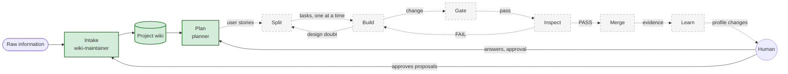

# Ergon: the factory

The whole factory. Solid boxes are built; dashed boxes are designed but not built.
Each node describes itself in `nodes/<node>/AGENTS.md`.

## The factory

## Nodes

- [Intake](../nodes/intake/AGENTS.md)
- [Plan](../nodes/plan/AGENTS.md)
