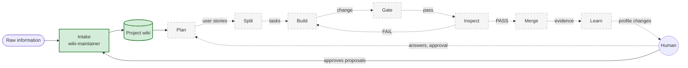
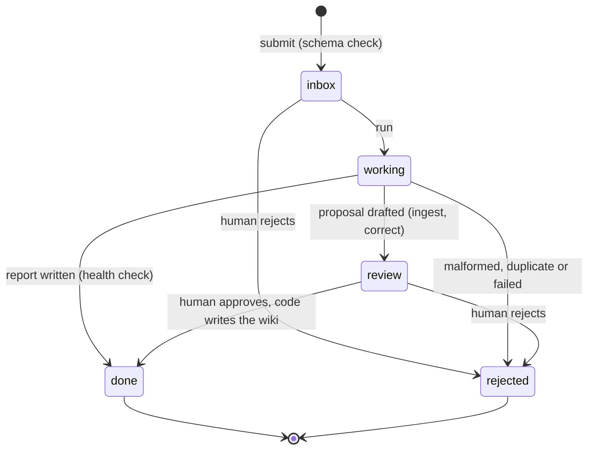
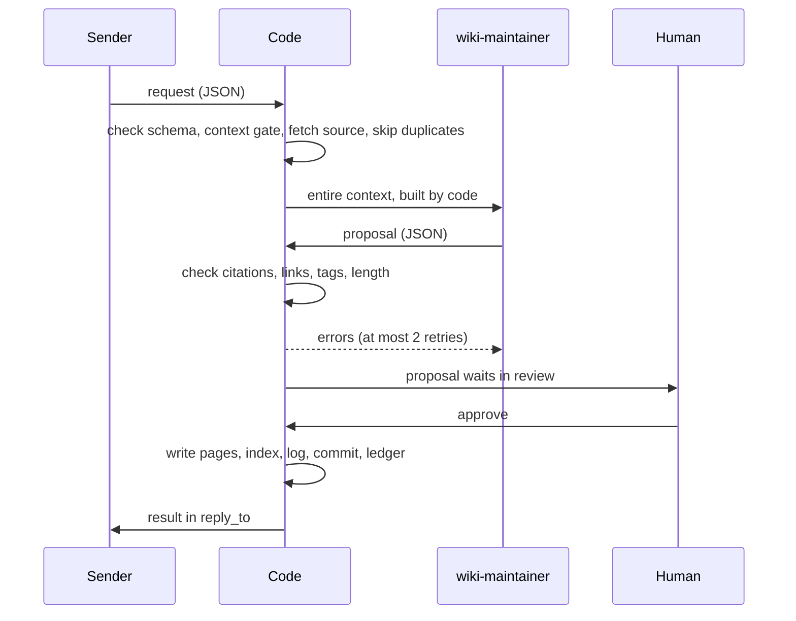

# Ergon: current state

Updated with every change to ergon. Solid boxes are built; dashed boxes are designed but not built.

## The factory

## Intake: the belt

## Intake: who does what in one ingest

