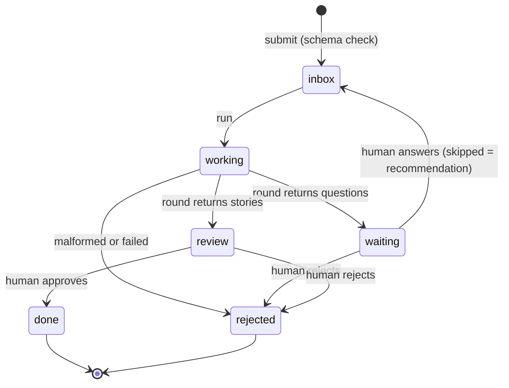

# Plan: diagrams

Back to [the factory](../../docs/factory.md).

## The belt



## Who does what in one plan

```mermaid
sequenceDiagram
    participant H as Human
    participant C as Code
    participant P as planner
    H->>C: plan request (goal)
    loop at most 5 rounds
        C->>P: prompt: goal, wiki index, earlier rounds; tool scope
        P->>C: search_wiki, read_pages (logged)
        P->>C: questions or stories (JSON)
        C->>C: check contract, ids, options, wiki sources
        C-->>P: errors (at most 2 retries)
        C->>H: questions wait in pending
        H->>C: answers (JSON)
    end
    C->>H: stories wait for approval
    H->>C: approve
    C->>H: stories.json, result in reply_to
```
